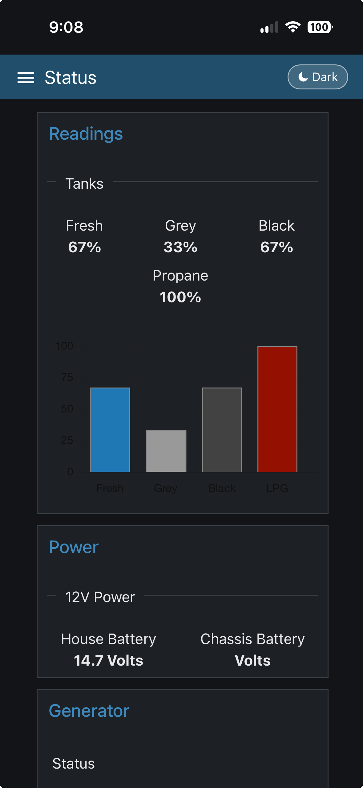
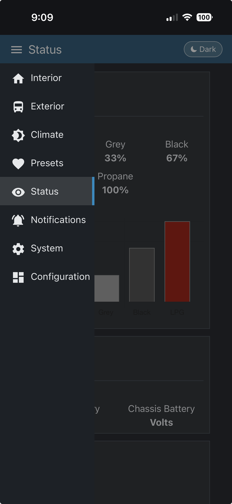

# CoachProxy dark mode

Dark mode for the [CoachProxyOS](https://github.com/linuxkidd/coachproxy-os) dashboard (Node-RED + `node-red-dashboard` 2.x). Unofficial and not affiliated with the CoachProxyOS project. Tested on CoachProxyOS v1.1.1.

- A pill button in the top bar cycles **Auto → Light → Dark**.
- **Auto** follows the device's light/dark setting and changes live.
- The choice is saved in the browser (`localStorage`), so it persists per device.
- Light mode is unchanged: all CSS is scoped to `html[data-cp-theme="dark"]`.

## Screenshots
<!-- Add two images to the screenshots/ folder, then keep these filenames (or edit the paths below). -->
| Dark mode | Side menu |
| --- | --- |
|  |  |

## How it works
It adds one `<style>` and one `<script>` (between `cp-dark-mode:start/end` comment markers) to the global **Custom CSS** `ui_template` node that CoachProxyOS loads on every tab. `deploy.py` patches only that node through the Node-RED admin API, so the rest of your flow is untouched and nothing else restarts. It appends to whatever is in the node now, so your own edits there are kept, and `--rollback` removes only the marked block.

The node is found by its stock id (`165202ff.dbfd0d`, the same in the upstream flow template), or else as the only global template named "Custom CSS". Use `--node-id` for anything else; any global `ui_template` is loaded on every tab.

## Install
Needs Python 3 on any computer that can reach Node-RED. No extra packages.
```sh
git clone https://github.com/schmiechen/coachproxy-dark-mode && cd coachproxy-dark-mode
python3 deploy.py --url http://<your-coachproxy>:1880              # dry run: shows the diff
python3 deploy.py --url http://<your-coachproxy>:1880 --apply      # backs up flows to backups/, then installs
python3 deploy.py --url http://<your-coachproxy>:1880 --rollback   # removes it again
```
Then hard-refresh the dashboard (or close and reopen the tab). If your Node-RED admin API needs a login, add `--token <access token>`. Re-running `--apply` is safe: it replaces the block instead of duplicating it.

## Notes
- The dashboard theme forces light backgrounds with `!important` (e.g. on `.nr-dashboard-template p`), so overrides need `!important` and higher specificity.
- Don't change the DOM unconditionally inside the `MutationObserver` callback: that loops forever and blanks the dashboard.

## License
GPL-3.0, the same license as CoachProxyOS. See [LICENSE](LICENSE).
